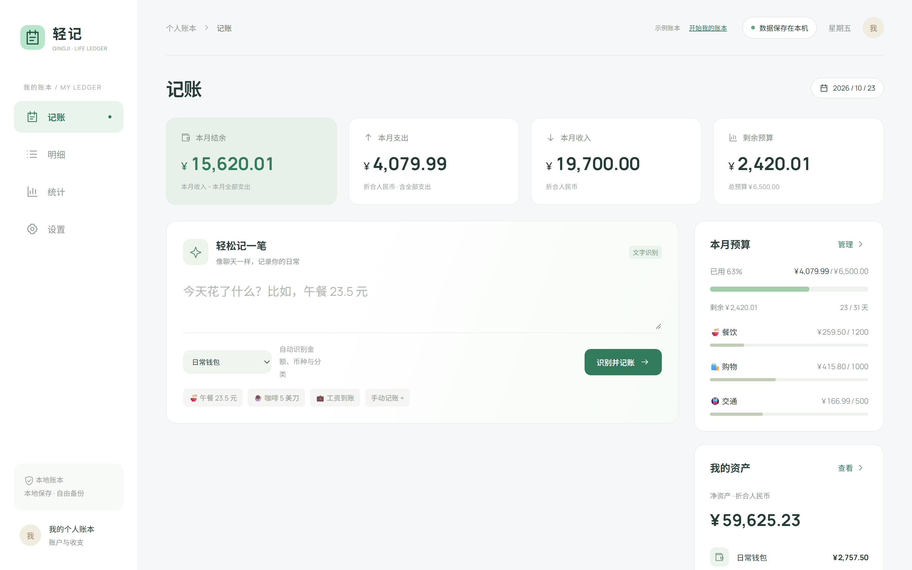
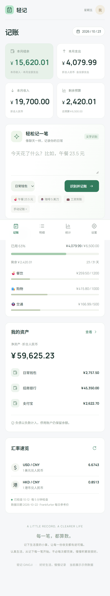
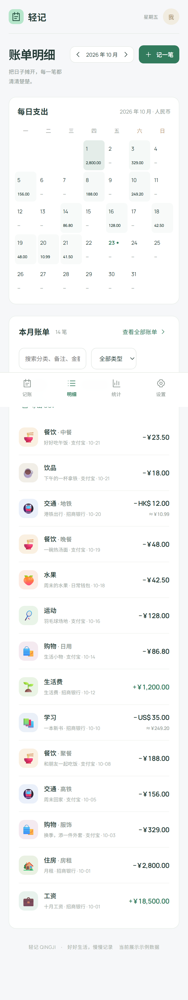
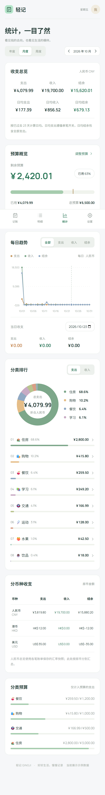
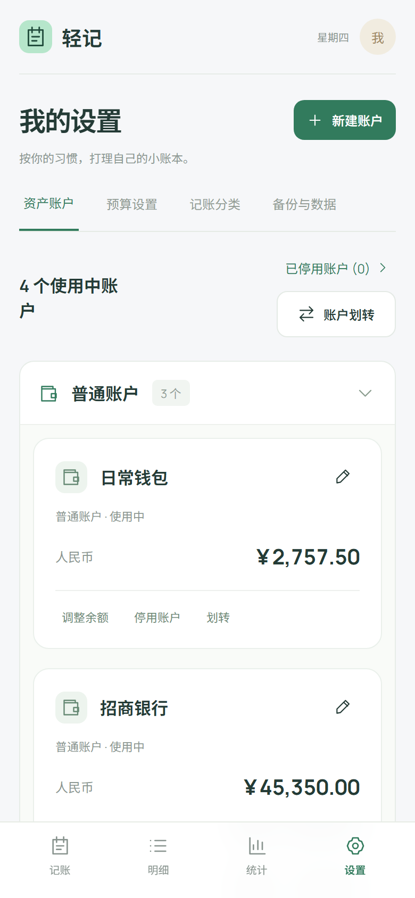

# 轻记 · 让生活有数

> 一个单文件、零依赖、离线优先的个人记账 Web App。**在线体验：[lihalf0312.github.io/qingji](https://lihalf0312.github.io/qingji/)**（内置示例账本，打开即可把玩，右上角可一键开始自己的账本）



| 记账 | 明细 | 统计 | 设置 |
| :---: | :---: | :---: | :---: |
|  |  |  |  |

## 它是什么

- **单 HTML 文件**（约 90 KB）：无框架、无构建、无后端、无外部依赖，双击即用，GitHub Pages / 任意静态托管皆可部署。
- **移动优先，桌面自适应**：手机上底部 Tab，宽屏自动切为侧边栏布局。
- **数据完全本地**：所有数据存在浏览器 localStorage，不上传任何服务器；支持一键导出/恢复 JSON 完整备份、导出 CSV。
- **Vibe Coding 项目**：由 AI 辅助完成从需求拆解到部署的全流程，人负责定义需求、验收标准与迭代方向。

## 功能

- **自然语言快捷记账**：输入「午餐 23.5 元」「咖啡 5 美刀」，自动解析金额、分类、币种并匹配账户。
- **多币种记账**：CNY / HKD / USD 混合记账，汇率逐笔折算并保留 `rate / rateDate / rateSource` 审计字段，资产总额按当前汇率汇总。
- **多账户体系**：普通账户、信用卡等类型，支持多币种余额、账户分组、停用账户归档。
- **余额校准**：针对真实账本中"账面余额与实际不符"的场景，提供余额校准机制并留痕。
- **支出日历**：明细页顶部的月历视图，每日支出按金额深浅着色，点选某天直接过滤当日账单。
- **趋势选日**：每日趋势图支持点选具体某天，展示当日支出、收入与结余明细。
- **账户下钻**：任一账户可点入查看该账户的全部账单流水，与分类排行同级体验。
- **预算与统计**：月度总预算 + 分类预算，按日/周/月/年切换，收支总览、日均、分类排行、趋势图。
- **CSV 迁移**：内置迁移种子机制，可将既有 CSV 账单（2000+ 笔）完整导入并校验。
- **示例账本模式**：首次访问展示一套假数据，不与真实数据混淆；存储键分离，互不污染。

## 技术要点

| 维度 | 取舍 |
| --- | --- |
| 架构 | 单文件、无构建链；状态为单一对象，`render()` 全量重绘 |
| 持久化 | localStorage（带版本号的状态结构，首次访问注入种子） |
| 多币种 | 交易记录当时汇率 + 来源，历史金额不随汇率变动漂移 |
| 性能 | 2000+ 笔账单下的列表渲染与统计聚合保持流畅 |
| 隐私 | 数据不出浏览器；演示数据与个人数据通过构建管线分离 |

## 与 AI 的协作方式（Vibe Coding）

这个项目不是"AI 生成后直接丢上线"：需求、数据模型、边界场景和验收标准由人定义，AI 负责实现，再由人用真实数据验收、报 bug、迭代修复。几轮典型的迭代包括：

1. **数据模型演进**：从单币种简单流水，演进为多币种 + 逐笔汇率审计（解决"历史账目被当前汇率污染"的问题）。
2. **余额一致性**：引入余额校准与单笔开关（是否计入统计），处理真实对账差异。
3. **数据分离构建**：真实账本（约 1.4 MB 种子）与演示版本分离，演示版通过脚本注入示例状态，保证线上可展示且不泄露隐私。
4. **边界场景回归**：多币种消费、跨月日期等场景的记账与统计口径验证。

## 本地运行

```bash
# 直接双击 index.html 即可；或起个静态服务：
python -m http.server 8080
# 打开 http://localhost:8080
```

## License

[MIT](LICENSE)
